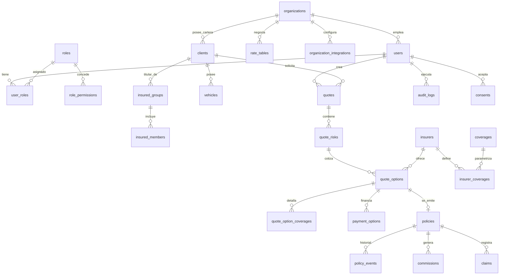

# Delta Check — Arquitectura y Guía de Desarrollo

> Documento operativo. Es la fuente de verdad para el desarrollo: estructura, esquema de datos, convenciones y seguridad. Se actualiza al cerrar cada fase.

- **Producto:** Delta Check — cotizador comparativo para agentes de un broker de seguros.
- **Plataforma:** Web responsive (Next.js App Router). No hay app nativa en el alcance.
- **Reemplaza:** `COTIZADOR DELTA.xlsm` (30 hojas, macros VBA).
- **Usuarios:** agentes/ejecutivos del broker. **No es un portal público de clientes.**
- **Cliente inicial:** Delta Seguros. **Horizonte de negocio:** el producto se planea arrendar a otros brokers como SaaS — la arquitectura se diseña multi-tenant desde Fase 1 (§1b), no como algo que se agrega después.

---

## 1. Stack

| Capa | Elección | Nota |
|---|---|---|
| Framework | Next.js 16 (App Router, Server Components) | RSC por defecto; `"use client"` solo en hojas interactivas |
| Lenguaje | TypeScript `strict: true` | `noUncheckedIndexedAccess` activo |
| UI | Tailwind CSS + shadcn/ui | Tokens de marca Delta (§7) |
| DB | PostgreSQL 16 | Fuente de verdad transaccional |
| ORM | Drizzle ORM | SQL-first, migraciones versionadas en repo |
| Cache/colas | Redis (Upstash) | Rate limiting, cache de tasas, sesiones de cotización |
| Auth | Auth.js v5 (NextAuth) | Microsoft Entra ID + Google + Email (magic link) |
| Validación | Zod | Un solo esquema compartido cliente/servidor |
| PDF | React-PDF (`@react-pdf/renderer`) en Server Action | Genera la carátula |
| Tests | Vitest + Playwright | Dominio con Vitest; flujo de cotización con Playwright |

> **Nota Next.js 16:** el archivo de interceptación de requests (guard de sesión, RBAC por ruta, headers de CSP) se llama **`proxy.ts`** con función exportada `proxy`, no `middleware.ts`/`middleware` — Next.js 16 renombró la convención y corre siempre en runtime `nodejs` (ya no en `edge`). Verificado contra los docs versionados que trae instalado `node_modules/next/dist/docs/` — no asumido de memoria.
>
> **Nota Auth.js v5:** `Session` se declara en `@auth/core/types`, no en `next-auth` (que solo lo re-exporta) — pero incluso augmentando el módulo correcto, la fusión de tipos no aplicó de forma confiable en este proyecto (`Session extends DefaultSession {}` con cuerpo propio vacío). Se resolvió centralizando la sesión en `getAppSession()` (`src/lib/auth.ts`) — un solo cast, documentado, en un solo lugar — en vez de perseguir el caso límite de TypeScript. Cualquier código nuevo que necesite `organizationId`/`userId` de la sesión usa ese helper, nunca `auth()` crudo.

**Por qué este stack soporta las APIs futuras (Fase 4):** la capa de aseguradoras se define como un *puerto* (`InsurerGateway`). En Fase 1 el adaptador es `ManualRateAdapter` (lee tasas de la BD); en Fase 4 se agregan `AigApiAdapter`, `ZurichApiAdapter`, etc. implementando la misma interfaz. **Ningún componente ni servicio de cotización cambia** cuando se conecta una API real — solo se registra otro adaptador. Ver §5.

---

## 1b. Multi-tenencia — se construye desde Fase 1

Confirmaste que a futuro se arrienda a otros brokers. Esto **no se puede agregar después sin reescribir el esquema completo** — cada tabla de negocio necesita saber de qué broker es el dato desde el día uno, o la migración posterior implica tocar cada fila de cada tabla y auditar cada query en busca de fugas entre clientes. Se construye ahora, aunque el único inquilino por un buen tiempo sea Delta.

### Estrategia: una sola base de datos, `organization_id` + Row-Level Security de Postgres

No uso base de datos separada ni schema separado por broker. Con un equipo de una persona y el volumen de datos de una correduría (miles de cotizaciones, no millones), esa separación solo agrega costo operativo — N migraciones, N backups, N pools de conexión — sin comprarte una garantía de aislamiento que RLS no te dé ya.

**Cómo funciona la garantía:** cada tabla de negocio lleva `organization_id`. Postgres tiene una política RLS que dice, literalmente, "esta fila solo es visible si `organization_id` = el tenant de la sesión actual". Esa política vive **en la base de datos**, no en el código de la aplicación — un bug en un Server Action que olvide filtrar por tenant no puede filtrar datos de otro broker, porque Postgres los rechaza antes de que lleguen a la app. Es la diferencia entre "confiar en que cada query esté bien escrita" y "que sea estructuralmente imposible escribirla mal".

```sql
-- Se activa una vez por tabla de negocio
ALTER TABLE clients ENABLE ROW LEVEL SECURITY;
CREATE POLICY tenant_isolation ON clients
  USING (organization_id = current_setting('app.current_org_id')::uuid);
```

```ts
// Cada request de un agente autenticado fija el tenant antes de cualquier query.
// No hay forma de "olvidarlo" porque vive en el middleware de sesión, no en cada handler.
//
// OJO: `SET LOCAL x = $1` no es SQL válido — Postgres solo acepta literales
// ahí, no parámetros (bug real, encontrado probando el flujo completo en el
// navegador). set_config(name, value, is_local) sí acepta parámetros;
// is_local=true es el equivalente exacto de SET LOCAL.
await db.execute(sql`SELECT set_config('app.current_org_id', ${session.organizationId}, true)`);
```

### Qué es del tenant y qué es compartido

| Dato | ¿Tenant-scoped? | Razón |
|---|---|---|
| `organizations` (el broker mismo) | — es el tenant | id, nombre, subdominio, marca (logo/colores para white-label), plan |
| `insurers` (catálogo de aseguradoras reales), `coverages` (catálogo de coberturas) | ❌ Compartido | AIG, Zurich, etc. son las mismas para cualquier broker ecuatoriano — no tiene sentido que cada tenant las recree |
| `rate_tables`, `rate_rules`, `deductible_rules`, `insurer_coverages` | ✅ Tenant-scoped, con modo plantilla — ver abajo | Cada broker tiene **tasas y comisiones negociadas distintas** con la misma aseguradora |
| `clients`, `vehicles`, `quotes`, `quote_risks`, `quote_options`, `policies`, `commissions`, `claims`, `consents`, `audit_logs` | ✅ Tenant-scoped, sin excepción | Cartera de cada broker, aislada por completo |
| `organization_integrations` (SoftSeguros y futuros sistemas externos) | ✅ Tenant-scoped | Ver §5b — esto es justo lo que resuelve tu requisito de que sea opcional |

### `rate_tables` como plantilla — confirmado que sí

Las tasas y comisiones de Delta con cada aseguradora **sí pueden servir de referencia para acelerar el onboarding de un broker nuevo**. No las comparto en vivo entre tenants (un tenant nunca debe cotizar en producción con la tasa negociada de otro — cada broker tiene su propio acuerdo comercial con la aseguradora); lo que se comparte es la **plantilla**, que el tenant nuevo clona a su propia tabla y confirma/ajusta antes de usarla.

```
rate_tables
  id
  organization_id       → dueño real de la fila (siempre tenant-scoped, sin excepción)
  visibility             'PRIVATE' (default) | 'TEMPLATE' — el PLATFORM_ADMIN marca cuáles de Delta son visibles como plantilla
  cloned_from_id          nullable, FK a otra rate_tables — trazabilidad de "de qué plantilla vino"
  is_confirmed            boolean, default false en las clonadas — bloquea su uso en cotizaciones reales hasta que el tenant la revisa
  ...
```

La política RLS necesita la excepción explícita, no un simple `organization_id = tenant`:

```sql
CREATE POLICY tenant_isolation_with_templates ON rate_tables
  USING (
    organization_id = current_setting('app.current_org_id')::uuid
    OR visibility = 'TEMPLATE'          -- lectura entre tenants, solo para plantillas
  )
  WITH CHECK (organization_id = current_setting('app.current_org_id')::uuid);  -- escribir sigue 100% aislado
```

`WITH CHECK` es la parte que importa: un tenant puede **leer** una plantilla de otro (para clonarla), pero jamás puede **escribir** fuera de su propio `organization_id` — el `USING` relaja la lectura, el `WITH CHECK` no relaja nada en la escritura. `rate_rules`/`deductible_rules` heredan la visibilidad de su `rate_table` padre en vez de duplicar el campo.

### RBAC con tenant

Se agrega un rol por encima de los que ya existían (`ADMIN`/`SUPERVISOR`/`AGENTE`/`LECTOR`, que ahora quedan **dentro** de una organización):

| Rol | Alcance |
|---|---|
| `PLATFORM_ADMIN` | Tu equipo. Cross-tenant: crea/gestiona brokers, ve todos los `organization_integrations`, administra el catálogo compartido de aseguradoras |
| `ADMIN` (por tenant) | Todo dentro de **su** organización |
| `SUPERVISOR` / `AGENTE` / `LECTOR` | Igual que en §8.4, pero ya implícitamente acotado a una organización |

### Costo de hacerlo ahora vs. después

Diseñar `organization_id` + RLS desde Fase 1 agrega trabajo real (no es gratis), pero es una fracción de lo que costaría retrofitarlo cuando ya haya datos reales de Delta en producción y un segundo broker esperando. Lo incorporo al alcance de Fase 1 sin tocar el resto del plan — si quieres que recalcule el número, lo hago, pero no es la prioridad de esta conversación.

---

## 2. Principios de código (obligatorios)

- **DDD** — La lógica de negocio vive en `src/domains/<dominio>/`, nunca en componentes. Los componentes delegan.
- **Clean Architecture** — Componentes = presentación. Servicios = negocio + acceso a datos. La dirección de dependencia siempre apunta hacia adentro: `app/ → domains/services → domains/repositories → db`. El dominio **no importa** nada de `app/` ni de React.
- **DRY** — Sin duplicación. **Sin métodos wrapper** (`getClientById` que solo llama a `repo.findById` no existe: se llama al repo). Soluciones genéricas parametrizadas.
- **Responsabilidad única** — Un propósito por clase/método.

### Traducción del principio "public readonly" a React

> El principio original (`servicios public readonly para acceso directo desde el template`) viene de Angular con DI. **Equivalente aquí:** los Server Components invocan las funciones del servicio de dominio directamente, sin capa intermedia de "controlador" ni wrappers de API.

```tsx
// ✅ Server Component llama al servicio directamente. Sin wrapper, sin fetch interno.
import { quoteService } from "@/domains/quoting/services/quote.service";

export default async function QuotePage({ params }: { params: Promise<{ id: string }> }) {
  const { id } = await params;
  const quote = await quoteService.getComparison(id); // acceso directo
  return <ComparisonTable data={quote} />;
}
```

```tsx
// ❌ Prohibido: componente con lógica de negocio
export default async function QuotePage() {
  const rows = await db.select().from(quotes);           // acceso a datos en componente
  const prima = rows[0].neta * 1.035 * 1.005 * 1.15;     // regla de negocio en componente
}
```

**Regla dura:** si aparece un cálculo de prima, impuesto o comparación fuera de `src/domains/`, es un bug de arquitectura.

---

## 3. Estructura de carpetas

```
delta-check/
├─ src/
│  ├─ app/                                  # SOLO routing + presentación
│  │  ├─ (auth)/
│  │  │  ├─ login/page.tsx
│  │  │  └─ consent/page.tsx                # aceptación de políticas (§8)
│  │  ├─ (dashboard)/
│  │  │  ├─ layout.tsx                      # shell + guard de sesión
│  │  │  ├─ page.tsx                        # resumen / KPIs
│  │  │  ├─ cotizar/
│  │  │  │  ├─ autos/
│  │  │  │  │  ├─ page.tsx                  # paso 1: datos
│  │  │  │  │  └─ [quoteId]/comparar/page.tsx
│  │  │  │  └─ salud/…
│  │  │  ├─ cartera/                        # emisiones, pendientes, canceladas
│  │  │  ├─ comisiones/
│  │  │  ├─ siniestros/
│  │  │  └─ admin/                          # solo ADMIN: usuarios, tasas, aseguradoras
│  │  ├─ api/
│  │  │  ├─ auth/[...nextauth]/route.ts
│  │  │  └─ webhooks/insurers/[slug]/route.ts   # Fase 4
│  │  └─ layout.tsx
│  │
│  ├─ domains/                              # ⬅ TODA la lógica de negocio
│  │  ├─ shared/
│  │  │  ├─ money.ts                        # dinero en centavos (bigint). Nunca float.
│  │  │  ├─ result.ts                       # Result<T,E>, sin excepciones para flujo esperado
│  │  │  └─ audit.ts
│  │  ├─ identity/                          # usuarios, roles, permisos
│  │  │  ├─ services/rbac.service.ts
│  │  │  └─ repositories/user.repository.ts
│  │  ├─ clients/                           # cliente, vehículo, grupo familiar
│  │  ├─ catalog/                           # aseguradoras, coberturas, tasas
│  │  │  ├─ services/rate.service.ts
│  │  │  └─ repositories/rate.repository.ts
│  │  ├─ quoting/                           # ⬅ núcleo
│  │  │  ├─ services/
│  │  │  │  ├─ quote.service.ts             # orquesta la cotización
│  │  │  │  ├─ premium.calculator.ts        # prima neta → impuestos → total
│  │  │  │  └─ comparison.service.ts        # ranking / mejor opción
│  │  │  ├─ gateways/                       # puerto + adaptadores (§5)
│  │  │  │  ├─ insurer.gateway.ts           # interfaz
│  │  │  │  ├─ manual.adapter.ts            # Fase 1
│  │  │  │  └─ api/                         # Fase 4: aig.adapter.ts, zurich.adapter.ts…
│  │  │  └─ schemas/quote.schema.ts         # Zod, compartido cliente/servidor
│  │  ├─ policies/                          # emisión, cartera, cancelaciones
│  │  ├─ commissions/
│  │  └─ claims/                            # siniestros
│  │
│  ├─ components/                           # presentación pura, sin lógica de negocio
│  │  ├─ ui/                                # shadcn
│  │  └─ quoting/ComparisonTable.tsx
│  ├─ actions/                              # Server Actions: validan (Zod) → llaman servicio → revalidan
│  ├─ db/
│  │  ├─ schema/                            # Drizzle: un archivo por agregado
│  │  ├─ migrations/
│  │  └─ index.ts
│  └─ lib/
│     ├─ auth.ts                            # Auth.js config
│     ├─ rate-limit.ts
│     └─ env.ts                             # Zod sobre process.env; falla al build si falta algo
├─ e2e/
└─ drizzle.config.ts
```

---

## 4. Esquema lógico de base de datos

Convenciones: `snake_case`; PK `id uuid default gen_random_uuid()`; `created_at/updated_at timestamptz`; **dinero en `bigint` (centavos USD)**, jamás `float`; borrado lógico con `deleted_at` en entidades de negocio.

### 4.1 Diagrama de relaciones



### 4.2 Tablas

> **Multi-tenencia (§1b):** toda tabla marcada 🏢 lleva `organization_id → organizations` y política RLS. Las marcadas 🌐 son catálogo compartido entre todos los tenants.

**Organización (tenant)**

| Tabla | Campos clave |
|---|---|
| `organizations` 🌐 | `id`, `name`, `slug` (subdominio), `logo_url`, `brand_primary_color`, `brand_secondary_color`, `plan`, `is_active`, `created_at` |
| `organization_integrations` 🏢 | `id`, `organization_id`, `provider` (`SOFTSEGUROS`…), `enabled`, `credentials` (jsonb cifrado), `config` (jsonb) — ver §5b.3 |

**Identidad y RBAC**

| Tabla | Campos clave |
|---|---|
| `users` 🏢 | `id`, `organization_id` (nulo solo para `PLATFORM_ADMIN`), `email` (unique, citext), `full_name`, `provider` (`microsoft`\|`google`\|`email`), `provider_account_id`, `is_active`, `last_login_at` |
| `roles` 🌐 | `id`, `code` (`PLATFORM_ADMIN`\|`ADMIN`\|`SUPERVISOR`\|`AGENTE`\|`LECTOR`), `name` — catálogo fijo, no por tenant |
| `permissions` 🌐 | `id`, `code` (ej. `quote:create`, `rate:edit`, `commission:read_all`) |
| `role_permissions` 🌐 | `role_id`, `permission_id` (PK compuesta) |
| `user_roles` 🏢 | `user_id`, `role_id` (PK compuesta) |

**Clientes y objetos asegurados** (🏢 todas)

| Tabla | Campos clave |
|---|---|
| `clients` | `id`, `person_type` (`NATURAL`\|`JURIDICA`), `document_type` (`CEDULA`\|`RUC`\|`PASAPORTE`), `document_number` (unique + índice), `first_name`, `last_name`, `business_name`, `email`, `phone`, `source` (FUENTE del Excel), `assigned_agent_id → users` |
| `vehicles` | `id`, `client_id`, `plate`, `brand`, `model`, `year`, `body_type`, `color`, `chassis`, `commercial_value_cents`, `extras_value_cents`, `has_tracker` (afecta deducible de robo), `city` |
| `insured_groups` | `id`, `client_id`, `region` (`SIERRA`\|`COSTA`) — grupo de salud |
| `insured_members` | `id`, `group_id`, `relation` (`TITULAR`\|`DEPENDIENTE`), `age`, `gender`, `birth_date` |

**Catálogo de aseguradoras y tasas** (🌐 `insurers`/`coverages` compartidos · 🏢 el resto — tasas y comisiones negociadas, ver pregunta abierta en §1b)

| Tabla | Campos clave |
|---|---|
| `insurers` 🌐 | `id`, `code` (`AIG`,`SESA`,`GENERALI`,`ZURICH`,`SWEADEN`,`ATLANTIDA`,`ALIANZA`,`CONSTITUCION`,`UNIDOS`,`LATINA`,`ASEGSUR`,`CHUBB`,`CONDOR`,`BMI`,`HUMANA`,`SALUDSA`,`CONFIAMED`,`BUPA`…), `name`, `branch` (`AUTOS`\|`SALUD`), `logo_url`, `is_active`, `integration_mode` (`MANUAL`\|`API`) |
| `coverages` 🌐 | `id`, `code` (`RC`,`AP`,`GM`,`AUTO_SUSTITUTO`,`AMPARO_PATRIMONIAL`…), `name`, `branch`, `value_type` (`BOOLEAN`\|`AMOUNT`\|`TEXT`), `display_order` |
| `insurer_coverages` | `insurer_id`, `coverage_id`, `granted` (bool), `amount_cents`, `text_value`, `valid_from`, `valid_to` — **versionado por vigencia, nunca UPDATE destructivo** |
| `rate_tables` | `id`, `organization_id`, `insurer_id`, `branch`, `visibility` (`PRIVATE`\|`TEMPLATE`), `cloned_from_id`, `is_confirmed`, `valid_from`, `valid_to`, `created_by` — ver §1b para el modo plantilla |
| `rate_rules` | `id`, `rate_table_id`, `vehicle_age_min/max`, `value_min_cents`, `value_max_cents`, `body_type`, `usage_type`, `rate_percent` (`numeric(7,5)`), `min_premium_cents`, `emission_fee_cents` |
| `deductible_rules` | `id`, `insurer_id`, `kind` (`PARCIAL`\|`TOTAL_DANO`\|`TOTAL_ROBO`), `percent_of_loss`, `percent_of_insured_value`, `min_amount_cents`, `requires_tracker`, `text_label` |

**Cotización** (🏢 todas)

| Tabla | Campos clave |
|---|---|
| `quotes` | `id`, `code` (correlativo visible, ej. `COT-2026-00184`), `client_id`, `agent_id`, `branch`, `operation_type` (`NUEVA`\|`RENOVACION`), `status` (`BORRADOR`\|`ENVIADA`\|`ACEPTADA`\|`VENCIDA`), `previous_insurer_id`, `previous_policy_number`, `previous_expiry_date`, `valid_until`, `created_at` |
| `quote_risks` | `id`, `quote_id`, `risk_number` (1–4), `vehicle_id`, `insured_group_id`, `insured_value_cents`, `extras_value_cents` — soporta los "RIESGO 1..4" del Excel |
| `quote_options` | `id`, `quote_risk_id`, `insurer_id`, `modality` (`ANUAL`\|`POR_KM`), `net_premium_cents`, `super_bancos_cents` (3.50%), `campesino_cents` (0.50%), `emission_fee_cents`, `iva_cents` (15%), `total_premium_cents`, `rate_percent_applied`, `source` (`MANUAL`\|`API`), `raw_response` (jsonb, respuesta cruda de API), `quoted_at`, `is_recommended` |
| `quote_option_coverages` | `quote_option_id`, `coverage_id`, `granted`, `amount_cents`, `text_value` — **snapshot inmutable** de lo cotizado |
| `payment_options` | `id`, `quote_option_id`, `method` (`CONTADO`\|`TARJETA`), `installments` (6\|9\|12), `has_interest`, `installment_amount_cents` |

> **Regla clave:** `quote_option_coverages` guarda copia de las condiciones al momento de cotizar. Si la aseguradora cambia su cobertura mañana, la cotización enviada al cliente sigue siendo reproducible tal cual se emitió.

**Cartera, comisiones y siniestros** (🏢 todas — estados tomados literalmente del Excel)

| Tabla | Campos clave |
|---|---|
| `policies` | `id`, `quote_option_id`, `policy_number`, `insurer_id`, `client_id`, `branch`, `issue_status` (`PENDIENTE`\|`EMITIDA`\|`NO_EMITIDA`), `payment_status` (`PENDIENTE`\|`PAGADO`), `lifecycle_status` (`VIGENTE`\|`CANCELADA`), `inspection_required`, `starts_at`, `ends_at`, `premium_cents` |
| `policy_events` | `id`, `policy_id`, `event_type`, `from_status`, `to_status`, `notes`, `user_id`, `created_at` — historial append-only |
| `commissions` | `id`, `policy_id`, `insurer_id`, `agent_id`, `base_amount_cents`, `percent`, `amount_cents`, `status` (`PENDIENTE`\|`COMISIONADA`), `paid_at` |
| `claims` | `id`, `policy_id`, `claim_number`, `status` (`REPORTADO`\|`APROBADO`\|`REPARADO`), `occurred_at`, `reported_at`, `description`, `deductible_applied_cents` |

**Cumplimiento y auditoría** (🏢 todas — §8)

| Tabla | Campos clave |
|---|---|
| `consents` | `id`, `user_id`, `client_id`, `policy_version`, `terms_version`, `accepted_at`, `ip_address` (inet), `user_agent` |
| `audit_logs` | `id`, `user_id`, `action`, `entity_type`, `entity_id`, `ip_address` (inet), `user_agent`, `metadata` (jsonb), `created_at` — **append-only, sin UPDATE/DELETE** |

### 4.3 Índices mínimos

```sql
CREATE INDEX idx_quotes_agent_created   ON quotes (agent_id, created_at DESC);
CREATE INDEX idx_quotes_client          ON quotes (client_id);
CREATE INDEX idx_quote_options_risk     ON quote_options (quote_risk_id, total_premium_cents);
CREATE INDEX idx_policies_renewal       ON policies (ends_at) WHERE lifecycle_status = 'VIGENTE';
CREATE INDEX idx_clients_document       ON clients (document_number);
CREATE INDEX idx_audit_entity           ON audit_logs (entity_type, entity_id, created_at DESC);
CREATE INDEX idx_rate_rules_lookup      ON rate_rules (rate_table_id, vehicle_age_min, vehicle_age_max);
```

---

## 5. Puerto de aseguradoras (clave para Fase 4)

```ts
// src/domains/quoting/gateways/insurer.gateway.ts
import type { RiskInput, InsurerQuote } from "../schemas/quote.schema";

export interface InsurerGateway {
  readonly insurerCode: string;
  readonly mode: "MANUAL" | "API";
  quote(risk: RiskInput): Promise<InsurerQuote>;
}
```

```ts
// src/domains/quoting/gateways/manual.adapter.ts — Fase 1
export class ManualRateAdapter implements InsurerGateway {
  readonly mode = "MANUAL" as const;
  constructor(
    readonly insurerCode: string,
    private readonly rates: RateRepository,
    private readonly calculator: PremiumCalculator,
  ) {}

  async quote(risk: RiskInput): Promise<InsurerQuote> {
    const rule = await this.rates.findApplicableRule(this.insurerCode, risk);
    if (!rule) return { insurerCode: this.insurerCode, status: "NO_COTIZA" };
    return this.calculator.build(this.insurerCode, risk, rule);
  }
}
```

En Fase 4 se agrega `AigApiAdapter implements InsurerGateway` y se registra en el resolver. `quote.service.ts` no se modifica: sigue haciendo `Promise.allSettled` sobre los gateways activos. Una aseguradora caída no rompe la comparación — devuelve `NO_COTIZA` y las demás siguen.

---

## 5b. Integración con SoftSeguros (sistema de gestión interno de Delta)

Delta ya opera **SoftSeguros** (`app.softseguros.com`) para pólizas, pagos, renovaciones y notificaciones. Revisé su documentación pública (`/docs/auth`, `/docs/poliza`, `/docs/cliente`) — es una API REST real, no un sistema cerrado, y esto **cambia una decisión de diseño de Fase 3** que conviene resolver ahora aunque la integración se construya después.

### 5b.1 Qué expone la API

| Recurso | Endpoints relevantes | Contenido |
|---|---|---|
| Auth | `POST /api-token-auth/` | Basic Auth o Token (`Authorization: Token …`), sin OAuth2/JWT |
| Clientes | `POST/GET /api/cliente/`, `GET /api/cliente/listar_cliente_por_documento/` | Persona natural o jurídica. `tipo_documento` incluye `ruc`, `cedula`, `pasaporte` — compatible con Ecuador |
| Pólizas | `POST/PUT/GET /api/poliza/`, `GET /api/estadopoliza/` | Alta y estado de póliza, prima, IVA, comisión, vigencia |
| Pagos | `POST /api/poliza/{id}/crear_pagos_multiples/`, `POST /api/pagopoliza/{id}/comisionar/` | Cronograma de pagos y comisión por pago |
| Siniestros | `POST/GET /api/siniestro/`, `/api/amparoafectado/` | Alta y seguimiento de siniestro |
| Aseguradoras / ramos | `/api/aseguradora/`, `/api/ramomarca/`, `/api/ramo/` | Catálogo propio de aseguradoras y líneas de negocio |

⚠️ **Ojo con los impuestos:** el ejemplo de su propia documentación trae `porcentaje_iva_prima: 19.0` — es el IVA de Colombia (SoftSeguros es una plataforma regional). **Nunca debe calcular impuestos por nosotros** — Delta Check calcula IVA 15% / SB 3.5% / SC 0.5% de Ecuador (§6) y solo *envía* el resultado ya calculado a los campos `prima`, `iva`, `total` de SoftSeguros.

### 5b.2 La decisión de diseño

SoftSeguros ya hace, en producción, buena parte de lo que había diseñado para la **Fase 3** desde cero: seguimiento de pólizas emitidas, pagos, comisiones y siniestros. Construir eso otra vez en Delta Check sería trabajo duplicado y, peor, dos sistemas de verdad divergentes (¿cuál manda si Delta Check y SoftSeguros no coinciden?).

**Mi recomendación:** Delta Check es la fuente de verdad **solo del proceso de cotización** (todo lo que pasa antes de que exista una póliza: `quotes`, `quote_risks`, `quote_options`). En el momento en que el cliente acepta una oferta y se emite, Delta Check **empuja** esa póliza a SoftSeguros (`POST /api/poliza/` + `crear_pagos_multiples`) vía el mismo patrón de puerto/adaptador que `InsurerGateway`:

```ts
// src/domains/policies/gateways/policy-management.gateway.ts
export interface PolicyManagementGateway {
  createPolicy(input: NewPolicyInput): Promise<{ externalId: string }>;
  createPaymentSchedule(externalId: string, plan: PaymentPlan): Promise<void>;
  getPolicyStatus(externalId: string): Promise<PolicyStatus>;
}
// Fase de integración: SoftSegurosAdapter implements PolicyManagementGateway
```

Con esto, **Fase 3 deja de ser "construir back-office desde cero"** y pasa a ser mucho más liviana: las tablas `policies`/`commissions`/`claims` de `ARCHITECTURE.md` §4.2 quedan como **cache local de solo lectura** (para que los dashboards de Delta Check no dependan de la latencia/disponibilidad de SoftSeguros), sincronizada desde SoftSeguros — no como el sistema donde se gestionan directamente. Eso reduce trabajo (no hay que construir seguimiento de pagos/notificaciones/renovaciones desde cero, ya existe) y evita el problema de "dos verdades".

**Necesito que confirmes:** ¿estás de acuerdo con que SoftSeguros sea el sistema de registro para pólizas/pagos/comisiones/siniestros una vez emitidos, y Delta Check se enfoque en cotizar + comparar + empujar la emisión? Si en cambio quieres que Delta Check lleve su propio control independiente (por ejemplo, porque van a dejar SoftSeguros a futuro), el diseño de §4.2 se queda como está y la integración es una sincronización de dos vías, no una de una sola. Cambia cómo diseño Fase 3.

### 5b.3 Que quede opcional para futuros tenants — así se resuelve

Confirmaste que Delta Check se integra con SoftSeguros **para el trabajo de Delta**, pero que un broker futuro que la arriende no debe tener eso como requisito ni bloqueo. El patrón de puerto/adaptador de §5b.2 ya resuelve esto de forma natural — solo falta que la *decisión de qué adaptador usar* se resuelva por tenant, no de forma global:

```
organization_integrations
  id
  organization_id      → FK a organizations
  provider              'SOFTSEGUROS' | (futuro: otro sistema de gestión)
  enabled                boolean
  credentials            jsonb, cifrado a nivel de columna (nunca texto plano)
  config                 jsonb — mapeos específicos del tenant (ids de ramo, sede, vendedor en SoftSeguros)
```

En tiempo de ejecución, el resolver de `PolicyManagementGateway` busca si la organización tiene una fila `enabled=true` en `organization_integrations`. Si la tiene, usa `SoftSegurosAdapter`. **Si no la tiene —porque es un broker nuevo que todavía no usa SoftSeguros, o simplemente no quiere—, usa un `NullPolicyGateway`**: la emisión se guarda en Delta Check normalmente y no se empuja a ningún lado. Nada del flujo de cotización, comparación o generación de carátula depende de si esta integración existe. Eso es exactamente "que no sea impedimento tenerlo deshabilitado": es un `if` en un resolver, no una ramificación del producto.

### 5b.4 Histórico — se trae de SoftSeguros, no del Excel

Se descarta migrar el Excel (confirmado — `BASE VEHICULOS`, `EMISIONES`, `PENDIENTE`, `COMISIONES`, `CANCELADAS`, `SINIESTROS` están vacías de todos modos, ver `EXCEL-AUDIT.md`). El histórico real de Delta — pólizas activas, no renovadas, canceladas y creadas por error — vive en SoftSeguros, y ya lo cubre el mismo puerto: se le agrega el lado de **lectura**.

```ts
export interface PolicyManagementGateway {
  createPolicy(input: NewPolicyInput): Promise<{ externalId: string }>;
  createPaymentSchedule(externalId: string, plan: PaymentPlan): Promise<void>;
  getPolicyStatus(externalId: string): Promise<PolicyStatus>;
  listPolicies(filter: { since?: Date; page: number }): Promise<PagedResult<ExternalPolicy>>; // ← backfill histórico
}
```

`SoftSegurosAdapter.listPolicies` pagina `GET /api/poliza/` (su propia documentación dice máximo 10 registros por página) y cruza cada póliza contra `GET /api/estadopoliza/` para mapear su estado real. Esto reemplaza por completo la Fase 6 que había planteado como "migración de Excel con validación punto a punto" — ya no aplica, era la solución al problema equivocado.

**Lo que sigue pendiente para poder construir esto** (no para diseñarlo, ya está diseñado): credenciales de API de SoftSeguros, y el resultado real de `GET /api/estadopoliza/` en la cuenta de Delta — ahí van a aparecer los nombres exactos que usan para "vigente", "no renovada", "cancelada" y "creada por error" (es un catálogo propio de cada cuenta, no un enum fijo de SoftSeguros), y con eso mapeo cada uno a `policies.lifecycle_status`/`issue_status` sin adivinar. Las pólizas "creadas por error" probablemente se importan pero se excluyen de los dashboards por defecto — lo dejo como bandera (`is_void` o similar) en vez de borrarlas, para no perder el registro.

---

## 6. Código base — vista principal (comparador)

**Cálculo de prima** (impuestos ecuatorianos, tomados del Excel):

```ts
// src/domains/quoting/services/premium.calculator.ts
const SUPER_BANCOS = 0.035;  // 3.50%
const SEGURO_CAMPESINO = 0.005; // 0.50%
const IVA = 0.15;            // 15%

export function buildPremium(netCents: bigint, emissionFeeCents: bigint) {
  const superBancos = mulRate(netCents, SUPER_BANCOS);
  const campesino   = mulRate(netCents, SEGURO_CAMPESINO);
  const taxableBase = netCents + superBancos + campesino + emissionFeeCents;
  const iva         = mulRate(taxableBase, IVA);
  return {
    netCents,
    superBancosCents: superBancos,
    campesinoCents: campesino,
    emissionFeeCents,
    ivaCents: iva,
    totalCents: taxableBase + iva,
  };
}
```

**Página del comparador** (Server Component, sin lógica de negocio):

```tsx
// src/app/(dashboard)/cotizar/autos/[quoteId]/comparar/page.tsx
import { notFound } from "next/navigation";
import { requirePermission } from "@/domains/identity/services/rbac.service";
import { comparisonService } from "@/domains/quoting/services/comparison.service";
import { ComparisonTable } from "@/components/quoting/ComparisonTable";

export default async function CompararPage({
  params,
}: { params: Promise<{ quoteId: string }> }) {
  const { quoteId } = await params;
  const session = await requirePermission("quote:read");

  const comparison = await comparisonService.getForQuote(quoteId, session.user.id);
  if (!comparison) notFound();

  return (
    <section className="flex flex-col gap-6">
      <header>
        <h1 className="text-2xl font-semibold tracking-tight">
          Comparativa — {comparison.clientName}
        </h1>
        <p className="text-sm text-muted-foreground">
          {comparison.vehicleLabel} · {comparison.options.length} aseguradoras cotizadas
        </p>
      </header>
      <ComparisonTable comparison={comparison} />
    </section>
  );
}
```

**Server Action** (validar → servicio → revalidar → auditar):

```ts
// src/actions/quote.actions.ts
"use server";
import { revalidatePath } from "next/cache";
import { quoteInputSchema } from "@/domains/quoting/schemas/quote.schema";
import { quoteService } from "@/domains/quoting/services/quote.service";
import { requirePermission } from "@/domains/identity/services/rbac.service";
import { rateLimit } from "@/lib/rate-limit";
import { audit } from "@/domains/shared/audit";

export async function createQuote(formData: FormData) {
  const session = await requirePermission("quote:create");
  await rateLimit(`quote:${session.user.id}`, { limit: 30, window: "1m" });

  const parsed = quoteInputSchema.safeParse(Object.fromEntries(formData));
  if (!parsed.success) return { ok: false, errors: parsed.error.flatten() };

  const quote = await quoteService.create(parsed.data, session.user.id);
  await audit("quote.created", { entityId: quote.id, userId: session.user.id });

  revalidatePath("/cotizar/autos");
  return { ok: true, quoteId: quote.id };
}
```

---

## 7. Identidad visual

Colores extraídos del sitio real (`deltaseguros.com.ec`), ya aplicados en el MVP visual:

```css
--delta-navy: #152a52;   /* institucional */
--delta-navy-2: #1b325f;
--delta-blue: #01579e;   /* acento / CTA */
--delta-gray: #797c7f;
```

Logo: `Delta_Logocolor.png` (fondo claro) / `Delta_Logoblanco.png` (fondo oscuro).

---

## 8. Seguridad

### 8.1 Frontend
- **HTTPS + TLS 1.3** — forzado en el proveedor (Vercel lo entrega por defecto); HSTS `max-age=63072000; includeSubDomains; preload`.
- **CSP estricta** por middleware, con nonce por request:
  ```
  default-src 'self'; script-src 'self' 'nonce-{N}' https://www.google.com/recaptcha/;
  style-src 'self' 'nonce-{N}'; img-src 'self' data: https:; frame-ancestors 'none';
  object-src 'none'; base-uri 'self'
  ```
- Headers: `X-Frame-Options: DENY`, `X-Content-Type-Options: nosniff`, `Referrer-Policy: strict-origin-when-cross-origin`, `Permissions-Policy` restrictiva.
- **reCAPTCHA v3** en login por email y en el formulario de cotización; se valida el score **en el servidor** (umbral 0.5), nunca en cliente.
- **Ofuscación:** minificación + `productionBrowserSourceMaps: false`.
  > ⚠️ La ofuscación de JS no es un control de seguridad real — cualquier lógica sensible debe vivir en el servidor. Se incluye porque lo pediste, pero no sustituye a §8.2.

### 8.2 Backend / APIs
- **OAuth2/OIDC** vía Microsoft Entra ID y Google. Sesión en cookie `httpOnly`, `Secure`, `SameSite=Lax`, rotación en cada login. JWT solo para el canal servidor↔servidor de Fase 4 (credenciales de aseguradoras en un secret manager, nunca en la BD).
- **Rate limiting** (Redis, sliding window): login 5/min/IP · cotización 30/min/usuario · APIs de aseguradoras según el cupo de cada una.
- **Validación en servidor:** todo input pasa por Zod dentro de la Server Action **antes** de tocar el dominio. Drizzle usa consultas parametrizadas (sin SQL string). Sanitización de cualquier HTML con `isomorphic-dompurify`.
- Autorización por permiso en **cada** Server Action (`requirePermission`), nunca solo ocultando el botón en la UI.

### 8.3 Base de datos
- **Cifrado en reposo:** AES-256 a nivel de volumen (gestionado por el proveedor) + `pgcrypto` a nivel de columna para `document_number` y datos de contacto.
- **Enmascaramiento:** vistas `*_masked` (ej. cédula → `17****4001`) usadas por el rol `LECTOR`; el dato completo solo se expone con permiso `client:read_pii`.
- **Menor privilegio:** rol `app_rw` (CRUD, sin DDL) para la app · `app_ro` para reportes · `app_migrate` (DDL) solo en CI de migraciones. Ningún servicio usa el superusuario.
- **Nunca almacenar:** tarjetas de crédito ni contraseñas en texto plano. La forma de pago se guarda como *plan* (`CONTADO`/`TARJETA` + cuotas), **jamás el número de tarjeta**.

**⚠️ Hueco identificado, sin cerrar:** RLS con `FORCE` en `users` bloquea, por diseño, resolver "a qué `organization_id` pertenece este email" en el momento del login — todavía no hay tenant fijado para que la política deje pasar la fila. Hoy no se manifiesta porque el pool de conexión local corre como superusuario de Postgres (salta RLS por completo, verificado). En cuanto exista el rol `app_rw` de arriba, ese lookup se rompe tal como está. Solución pendiente de implementar: un rol de BD aparte y estrecho (`app_auth`, sin `FORCE RLS` o con una política de excepción explícita) usado *solo* por el callback de login de Auth.js para ese único lookup — nunca por el resto del código. No se construye todavía; queda documentado para no descubrirlo en producción.

### 8.4 Roles (RBAC)

| Rol | Alcance |
|---|---|
| `PLATFORM_ADMIN` | Cross-tenant (§1b) — tu equipo, no un usuario de ningún broker. Crea organizaciones, administra el catálogo compartido |
| `ADMIN` | Todo dentro de **su** organización: ABM de usuarios, tasas y aseguradoras propias |
| `SUPERVISOR` | Ve la cartera y comisiones de todos los agentes de su organización; no edita tasas |
| `AGENTE` | Cotiza, gestiona **sus** clientes y **sus** comisiones, dentro de su organización |
| `LECTOR` | Solo lectura, con PII enmascarada |

Los permisos se resuelven en BD (`role_permissions`), no hardcodeados: agregar un rol es un INSERT, no un deploy. La verificación de permiso (`requirePermission`) siempre valida rol **y** `organization_id` juntos — un `ADMIN` de un broker no puede actuar sobre datos de otro aunque adivine un ID.

---

## 9. Cumplimiento legal (Ecuador — LOPDP)

- **Consentimiento explícito:** checkbox **no premarcado** de Políticas de Privacidad y Términos de Uso. El botón **Cotizar** permanece deshabilitado hasta marcarlo. Se registra en `consents` con versión del documento, timestamp, IP y user-agent.
- **Trazabilidad:** cada acción crítica (cotizar, emitir, cancelar, exportar, ver PII) va a `audit_logs` con usuario, IP, hora, entidad y resultado. Tabla **append-only**: `REVOKE UPDATE, DELETE ON audit_logs FROM app_rw`.
- **Minimización:** solo se recolecta lo que la cotización requiere. Retención definida por política del broker (pendiente de confirmar con Delta — ver §11).
- **Derechos ARCO:** endpoints de exportación y eliminación de datos del titular (Fase 3).

---

## 10. Fases

| Fase | Alcance | Estado |
|---|---|---|
| 0 | MVP visual | ✅ Entregado |
| 1 | Auth + RBAC + clientes/vehículos + comparador Autos (13 aseguradoras) + modalidad Auto x Km + carátula PDF | ✅ Completa — falta login real (Microsoft/Google) |
| 2 | Módulo Salud (8 aseguradoras, titular + dependientes) | Pendiente |
| 3 | Cartera, comisiones, siniestros, KPIs, ARCO | Pendiente |
| 4 | Adaptadores API por aseguradora + integración SoftSeguros (push de emisión + backfill de histórico, §5b) | Pendiente |
| 5 | Despliegue, capacitación, entrega | Pendiente |

Presupuesto vigente en `README.md`.

---

## 11. Decisiones — resueltas y abiertas

Auditoría completa hecha sobre el archivo: las 198 macros VBA (`oletools`/`olevba`, cuerpo completo) y las fórmulas de las 30 hojas. Detalle exhaustivo, clasificación de macros y tablas de tarifas exportadas en **[`EXCEL-AUDIT.md`](./EXCEL-AUDIT.md)**. Resumen de lo accionable:

### 11.1 Tasas — ✅ resuelto, con matiz importante

**No están en las macros.** Las 198 subrutinas VBA son navegación (`HOME`, `DASHBOARD`), mostrar/ocultar variantes de plan (`BMI_MOSTRAR_OCULTAR_...`), alta en bases (`ALTA_EN_BASE_EMISIONES`) e impresión (`IMPRIMIR_OFERTA_VH`). **Ninguna calcula prima ni tasa.** El cálculo vive en fórmulas de hoja:

- **AIG, SESA, Generali, Zurich, Sweaden, Atlántida, Alianza, Constitución, Unidos, Asegsur, Chubb (11 de 13):** la celda de Prima Neta (`DATOS OFERTA!C31`, `D31`…) es un **valor literal `0`** — un input que el ejecutivo digita a mano por cotización. No hay tabla de tasas para estas 11 en el archivo.
- **Latina y Cóndor (2 de 13):** **sí tienen un motor de tasas real**, con fórmula `VLOOKUP` contra una tabla en `INFO GENERAL!AF7:AI25` — tasa por rango de valor asegurado × clase de vehículo (`LIVIANO`/`PICKUP`) × antigüedad (≤10 años tabla completa, 11–13 años tasa plana 3%, >13 "NO COTIZA"). Extraje esa tabla completa; la voy a sembrar directo en `rate_rules` en Fase 1 — son datos reales, no de ejemplo.

**Lo que necesito de ti:** para que Fase 1 cotice con cifras reales en las otras 11 aseguradoras, o me pasas la tabla de tasas de cada una (si existe en papel o en otro archivo), o el sistema arranca con esas 11 en modo "digitación manual por cotización" — exactamente como funciona hoy el Excel, solo que centralizado. No es un bloqueante: es la misma limitación que ya tienen, no una nueva.

**Auto x Km — verificado, mismo patrón.** `OFERTA KM!H37` deriva la prima neta a partir de `DATOS OFERTA X KM!E10`, que es un input manual (`0` literal) por cada uno de los 6 rangos de km. No hay tabla de tasas para esta modalidad tampoco. Consecuencia práctica: no hay que construir un motor de cálculo nuevo, solo una variante de formulario con 6 campos de precio (por rango de km) en vez de 1 campo anual — la estimación de +18h en §11.7 ya asumía esto y no cambia.

### 11.2 Comisiones — ✅ resuelto: sí, manual hasta Fase 4

En `BASE COMISIONES!O15` la columna es literalmente **"% COMISION"** como campo de texto/número que se llena a mano por póliza — no hay fórmula ni tabla por aseguradora en ningún lado del archivo. Confirmado: se guarda como **campo editable en `commissions.percent`**, sin valor por defecto, tal como ya trabajan hoy. Cuando se conecte una API de aseguradora en Fase 4, si esa API devuelve el % de comisión se autocompleta; si no, se sigue digitando a mano. Cero trabajo extra por esto.

### 11.3 Microsoft Entra ID — ✅ buenas noticias

Tener cuentas de **Exchange significa que ya tienen Microsoft 365**, y **todo tenant de M365 trae un tenant de Entra ID (Azure AD) incluido automáticamente** — no hay que comprar nada nuevo. Para confirmarlo y avanzar:

1. Alguien con rol de **Administrador global** o **Administrador de aplicaciones** entra a [entra.microsoft.com](https://entra.microsoft.com) con su cuenta corporativa.
2. Si entra, el tenant ya existe (va a ser el caso).
3. `Aplicaciones → Registros de aplicaciones → Nuevo registro`, agrega el redirect URI `https://<dominio-delta-check>/api/auth/callback/microsoft-entra-id`.
4. Me pasa `Tenant ID`, `Client ID` y genera un `Client Secret` — eso es todo lo que necesito para el login con Microsoft.

Si nadie en Delta tiene ese rol de administrador hoy, es cuestión de pedírselo a quien gestiona la suscripción de M365 (probablemente el mismo proveedor de correo/soporte IT).

### 11.4 Auto x Km — ✅ resuelto: entra en Fase 1

Confirmado también en las macros: `AUTOXKM()`, `DATOS_CLIENTE_XKM()`, `ALTA_EN_BASE_VEHICULOS_XKM()`, `ACTUALIZAR_BASE_VEHICULOS_XKM()`, `OFERTA_XKM()`, `IMPRIMIR_OFERTA_XKM()` — es un flujo paralelo completo al de Autos anual, con sus propias hojas (`DATOS OFERTA X KM`, `OFERTA KM`). Reutiliza la mayor parte del dominio (`quote_risks`, `quote_options`, catálogo de coberturas), así que el costo incremental es menor que construirlo desde cero, pero **no es gratis**: sube el presupuesto de Fase 1 en ~18h. Ya está reflejado en la tabla de §11.7 y en `README.md`.

### 11.4b Salud (AM) — hallazgo mayor: sí hay motor de tarifas real

A diferencia de Autos, la línea Salud **no depende de digitación manual**. Existe una hoja oculta (`BASES ASEGURADORAS AM`, 238×152 celdas) con tablas de tarifa reales por edad × región × plan × deducible para Humana, BMI, SaludSA, Pro, Confiamed y VB (Bupa y Salud genérica quedan por confirmar). Está exportada completa en [`reference-data/salud_bases_aseguradoras_am_RAW.csv`](./reference-data/salud_bases_aseguradoras_am_RAW.csv). Cambia el diseño de `rate_rules` para Fase 2: no es "tramo × tasa fija" como en Autos, es una tabla multidimensional. Detalle completo en `EXCEL-AUDIT.md` §2.3.

### 11.4c SoftSeguros — parcialmente resuelto

✅ Confirmado: se integra para Delta, y **debe ser opcional/deshabilitable para futuros tenants sin bloquear el producto** — resuelto con el patrón `organization_integrations` + `NullPolicyGateway` en §5b.3, ya reflejado en el esquema de §4.2.

Sigue abierto: si SoftSeguros queda como sistema de registro de pólizas/pagos/comisiones/siniestros (mi recomendación, §5b.2) o si Delta Check lleva su propio control en paralelo. Y, cuando toque construirla: credenciales de API y si el plan de SoftSeguros que tiene Delta habilita acceso a la API (no todos los planes SaaS lo hacen).

### 11.4d Multi-tenencia — resuelto

Ver §1b. Ambas preguntas cerradas:
1. ✅ **Sí, las tasas/comisiones de Delta sirven de plantilla.** `rate_tables` tiene modo `TEMPLATE`: un tenant nuevo clona la plantilla a su propia tabla (`cloned_from_id`) y queda `is_confirmed = false` hasta que la revisa — nunca cotiza en producción con la tasa negociada de otro broker sin confirmarla primero como propia. RLS lo permite en lectura, nunca en escritura.
2. ✅ El campo de marca (`organizations.brand_primary_color`, `brand_secondary_color`, `logo_url`) queda en el esquema desde ya. **El motor de theming (aplicarlo de verdad en la UI y en la carátula PDF) no se construye todavía** — se activa cuando exista un segundo tenant real, no antes.

### 11.5 Retención de datos — abierto

Sigue pendiente: ¿cuántos años deben conservarse cotizaciones y pólizas según la política interna del broker (o la normativa de seguros de la Superintendencia)? Afecta si `audit_logs` y `policies` llevan borrado/archivado automático.

### 11.6 Migración histórica — ✅ resuelto: no se migra el Excel, se importa desde SoftSeguros

Confirmado con el contenido real (no solo el conteo de filas) de las 7 hojas `BASE *`: seis están completamente vacías (solo encabezados) y `BASE AM` tiene apenas 6 registros reales de salud (sep/2024–may/2025). El histórico real y completo de la empresa —pólizas activas, no renovadas, canceladas y creadas por error— vive en SoftSeguros, no en este archivo.

**Decisión:** se descarta migrar el Excel. El histórico se trae con `PolicyManagementGateway.listPolicies()` contra la API de SoftSeguros — mismo puerto que la integración de emisión, ver §5b.4. Deja de existir como "Fase 6" separada; es parte de la Fase 4.

### 11.7 Presupuesto actualizado

Con Auto x Km sumado a Fase 1 (el resto de fases no cambia):

| Fase | Horas | Precio |
|---|---|---|
| 1 — Plataforma base, Autos + Auto x Km | 94h | $1.128 |
| 2 — Salud | 30h | $365 |
| 3 — Back-office | 34h | $408 |
| 4 — API piloto (3 aseg.) + SoftSeguros (emisión + histórico, §5b) | 48h + *por definir* | $576 + *por definir* |
| 5 — Despliegue | 5h | $60 |

- **Base (1+3+5): $1.596**
- **Recomendado (1+2+3+5): $1.961**
- **Completo con piloto API (1–5): $2.537**

⚠️ No incluye todavía las horas de multi-tenencia (§1b) ni de la integración SoftSeguros (§5b) — se suman cuando se recalcule, ver nota en `README.md`.

---

## 12. Convenciones operativas

- **Commits:** Conventional Commits (`feat:`, `fix:`, `chore:`). Rama por fase: `fase-1-autos`.
- **Migraciones:** `drizzle-kit generate` → revisar SQL a mano → commit. Nunca `push` directo a producción.
- **Sin datos reales de clientes en desarrollo.** Seeds sintéticos en `src/db/seed.ts`.
- **Definition of done por fase:** tests de dominio en verde · flujo E2E principal en verde · migración aplicada · `ARCHITECTURE.md` actualizado.
